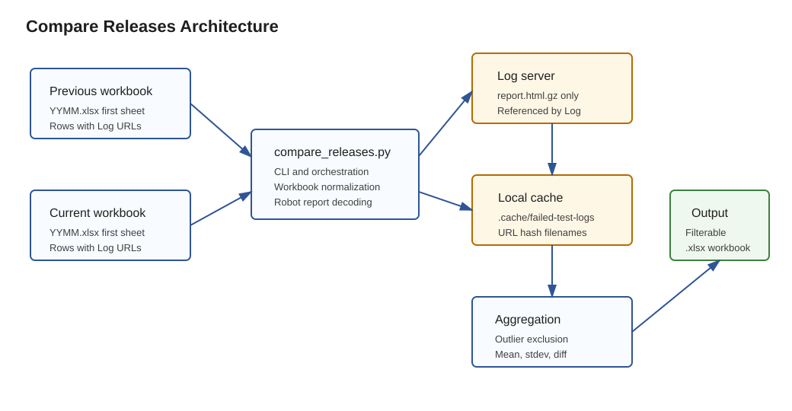
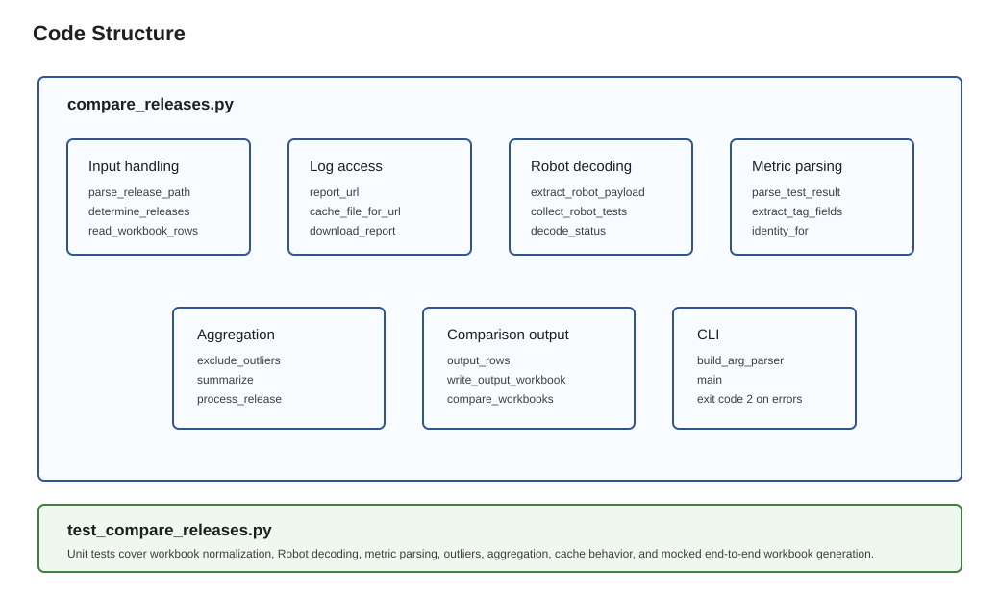
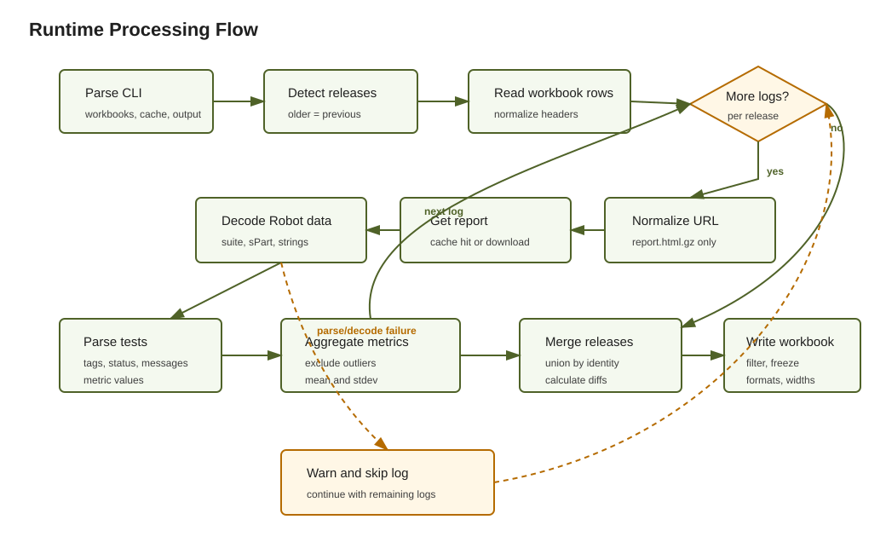

# Compare Releases

Compare Releases is a Python command-line tool for comparing performance test
data from two releases of the same product. It reads two input Excel workbooks,
downloads the Robot Framework `report.html.gz` logs referenced by their `Log`
columns, extracts test results and tags, aggregates repeated runs, and writes a
filterable Excel workbook with current, previous, diff, and relative-diff
columns.

## Project Files

- `compare_releases.py`: CLI implementation and reusable parsing/aggregation functions.
- `test_compare_releases.py`: stdlib `unittest` test suite.
- [diagrams/architecture.svg](diagrams/architecture.svg): high-level architecture diagram.
- [diagrams/processing-flow.svg](diagrams/processing-flow.svg): runtime processing-flow diagram.
- [diagrams/code-structure.svg](diagrams/code-structure.svg): code-structure diagram.
- `task.md`: original task specification.

## Requirements

- Python 3.9 or newer.
- `openpyxl` for reading and writing `.xlsx` workbooks.

The tests use only Python's standard `unittest` library plus `openpyxl`, because
the implementation itself depends on `openpyxl`.

## Usage

```bash
python compare_releases.py 2602.xlsx 2606.xlsx
```

The two input workbook names must use `YYMM.xlsx`. The older release filename is
treated as previous, and the younger release filename is treated as current.
While it runs, the CLI prints progress messages for workbook loading, per-log
cache/download activity, parsed test counts, aggregation, and output writing.

Default output:

```text
comparison_2602_to_2606.xlsx
```

Example smoke run:

```bash
python compare_releases.py 2602.xlsx 2606.xlsx \
  --max-logs 2 \
  --cache-dir /tmp/compare-releases-cache \
  -o /tmp/compare-releases-smoke.xlsx
```

## Command-Line Parameters

- `WORKBOOK WORKBOOK`: exactly two input workbooks named `YYMM.xlsx`.
- `-o, --output PATH`: output workbook path. Defaults to `comparison_<previous>_to_<current>.xlsx`.
- `--cache-dir PATH`: downloaded log cache. Defaults to `.cache/failed-test-logs`.
- `--timeout SECONDS`: per-download timeout. Defaults to `60`.
- `--retries COUNT`: retry count after a failed download. Defaults to `2`.
- `--offline`: use cached logs only and fail if any required log is missing.
- `--max-logs COUNT`: process at most this many non-empty log rows per workbook. This is intended for diagnostics and smoke tests.

## Input Tables

The first sheet of each workbook is read. Required columns:

- `DUT`
- `Node`
- `Job type`
- `Test type`
- `Log`

Optional columns:

- `Testbed`

Duplicate headers are supported. If a workbook has duplicate `Log` columns, the
first non-empty `Log` cell in that row is used. Missing optional fields are
written as blank output cells.

The tool downloads only `report.html.gz` from each log directory. If a `Log`
value already ends with `/report.html.gz`, that URL is used directly; otherwise
`/report.html.gz` is appended.

## Output Workbook

The output workbook contains one `Comparison` sheet with these columns, in this
order:

```text
DUT, Node, Job type, Test type, Status, NIC, Driver, Framesize,
Number of cores, Test area, Mean current, Stdev current, Mean NDR current,
Stdev NDR current, Mean PDR current, Stdev PDR current, Mean previous,
Stdev previous, Mean NDR previous, Stdev NDR previous, Mean PDR previous,
Stdev PDR previous, Diff, Rel Diff, Diff NDR, Rel Diff NDR, Diff PDR,
Rel Diff PDR
```

The workbook has a frozen header row, autofilter, readable column widths,
numeric formats, and percentage formatting for relative diffs. The output does
not include source `Testbed`, `Log current`, or `Log previous` columns.

## Result Rules

Tests are identified by:

- `DUT`
- `Node`
- `Job type`
- `Test type`
- `NIC`
- `Driver`
- `Framesize`
- `Number of cores`
- `Test area`

Tag-derived fields are extracted from Robot test tags:

- `NIC_...` becomes `NIC`.
- `DRV_...` becomes `Driver`.
- Frame-size tags such as `64B`, `1518B`, and `IMIX` become `Framesize`.
- Core-count tags such as `1C`, `2C`, and `4C` become lowercase values such as `1c`.
- The lower-case/hyphenated tag matching the test name becomes `Test area`.

Supported result parsers:

- `mrr`: mean of `Maximum Receive Rate trial results ... [values]`.
- `gso`: mean of `iPerf3 trial results ... [values]`.
- `ndrpdr`: `NDR` and `PDR` pps values only.
- `hoststack`: `Transfer Rate` in `Kbytes/sec`.
- `soak`: `PLRsearch lower bound` pps or CPS value only.

Only Robot tests with `Status == Pass` contribute numeric values. Failed tests
are still represented in aggregate status. For repeated runs, pass-run values
are aggregated after outlier exclusion. A single remaining value is written as
the mean/result and leaves stdev blank.

Definitions:

- Mean uses arithmetic mean: `sum(values) / N`.
- Stdev uses the population-style `1/N` convention.
- Outliers are excluded with the MathWorld 1.5 times IQR rule:
  https://mathworld.wolfram.com/Outlier.html
- Diff is `current - previous` whenever the corresponding current and previous
  numeric values are available.
- Relative diff is stored as `(current - previous) / previous` and formatted as a percentage in Excel.

## Architecture

See [diagrams/architecture.svg](diagrams/architecture.svg).

[](diagrams/architecture.svg)

The main data path is:

1. CLI arguments select two release workbooks and runtime options.
2. Workbook rows are normalized into typed `WorkbookRow` records.
3. Log URLs are converted to `report.html.gz` URLs and cached under the cache directory.
4. Robot report JavaScript payloads are decoded into `RobotTest` records.
5. Tags and messages are parsed into test identities and metric values.
6. Current and previous aggregates are merged into output rows.
7. `openpyxl` writes the final filterable workbook.

## Design

The implementation intentionally keeps the tool in a single Python file, but the
code is separated into small pure functions for testability:

- Input handling: release filename parsing and workbook row normalization.
- Log access: URL normalization, cache naming, offline mode, retries.
- Robot decoding: extraction of `window.output["suite"]`, split `window.sPartN` suite chunks, and `window.output["strings"]`.
- Metric parsing: one parser per supported test type.
- Aggregation: outlier exclusion, mean, population stdev, pass/fail status, diff calculation.
- Workbook writing: stable output columns, autofilter, frozen header row, numeric formats.

The source workbooks are read-only from the script's perspective. Only the log
cache and the requested output workbook are written.

## Code Structure

See [diagrams/code-structure.svg](diagrams/code-structure.svg).

[](diagrams/code-structure.svg)

Important public functions for tests or reuse:

- `determine_releases`
- `read_workbook_rows`
- `download_report`
- `collect_robot_tests`
- `parse_test_result`
- `extract_tag_fields`
- `process_release`
- `output_rows`
- `write_output_workbook`
- `compare_workbooks`

## Processing Flow

See [diagrams/processing-flow.svg](diagrams/processing-flow.svg).

[](diagrams/processing-flow.svg)

The tool processes previous and current releases separately, then merges them by
test identity. Diffs are calculated when both sides have numeric values for the
relevant metric, even if the combined row status is `Fail`.

## Tests

Run the unit tests:

```bash
python -m unittest -v test_compare_releases.py
```

If your default Python does not have `openpyxl`, use a Python environment where
`openpyxl` is installed.

Covered scenarios include:

- Release filename parsing and previous/current selection.
- Duplicate `Log` headers and missing optional `Testbed`.
- Robot Framework report decoding from compact HTML fixtures, including split
  `window.sPartN` suite payloads.
- All five metric parsers.
- Outlier exclusion, one-value stdev behavior, and population stdev.
- Current/previous row merging, diff calculation, and NDR/PDR split metrics.
- Offline cache hits and missing-cache failures.
- Warning-and-continue behavior for malformed Robot reports.
- End-to-end workbook generation with a mocked log fetcher.

## Operational Notes

- `.cache/failed-test-logs` is reused across runs and is already covered by the existing `.gitignore` `.cache` rule.
- Use `--offline` for reproducible reruns after the cache is warm.
- Use `--max-logs` to debug parsing against a small subset before processing a full release workbook.
- Robot report parsing and decode failures are printed as `WARNING` messages
  with the affected log URL, then skipped so remaining logs can still be
  compared.
- Missing cached logs in `--offline` mode still fail the command, because
  offline mode cannot fetch replacement data.
- Missing input/log values produce blank output cells rather than synthetic zeroes.
