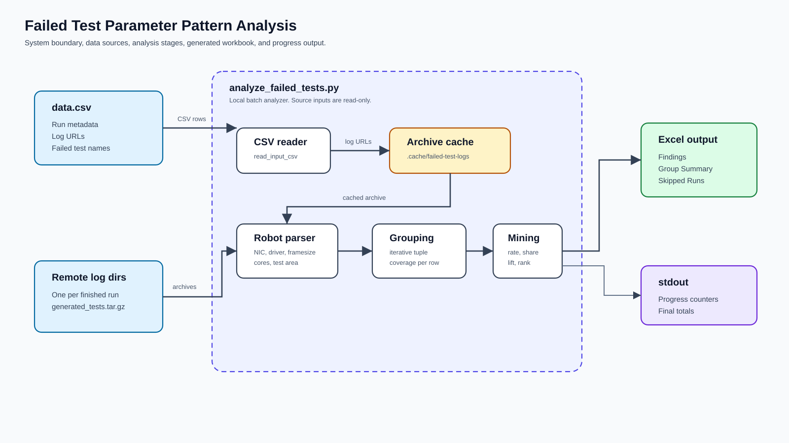
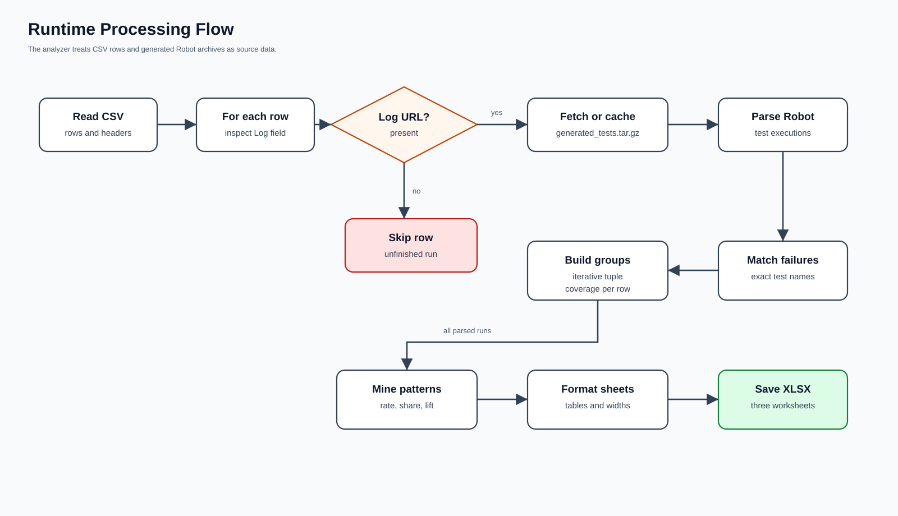
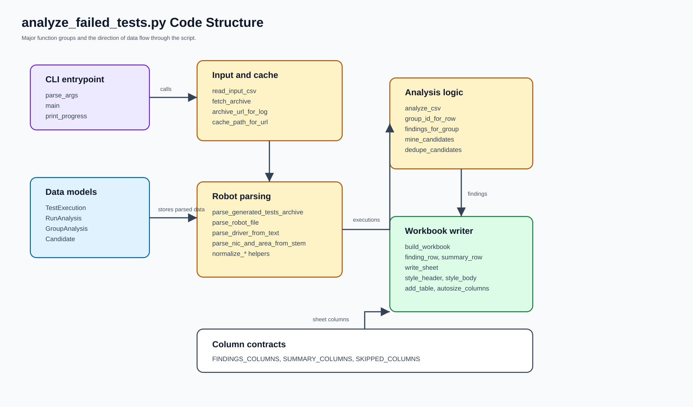

# Failed Test Parameter Pattern Analysis

This directory contains a Python tool for finding common and typical
parameters among failed CSIT test runs.

The script reads `data.csv`, fetches each run's generated Robot test archive
from the `Log` column, matches generated tests against the `Failed tests`
column, mines recurring parameter patterns, and writes an Excel workbook with
the results.

## Files

- `analyze_failed_tests.py` - command-line analyzer and Excel workbook writer.
- `test_analyze_failed_tests.py` - unit tests for grouping, parsing, and pattern
  mining behavior.
- `data.csv` - input data.
- `failed_test_parameter_patterns.xlsx` - generated output workbook.
- `diagrams/` - SVG architecture, processing-flow, and code-structure
  diagrams referenced by this README.
- `.cache/failed-test-logs/` - local cache of downloaded archives.

## Requirements

Use Python 3 with `openpyxl` installed.

The first run needs network access to download generated test archives from the
log URLs in `data.csv`. Later runs reuse `.cache/failed-test-logs/`.

## Usage

Run with defaults:

```bash
python3 analyze_failed_tests.py
```

Run with explicit input and output paths:

```bash
python3 analyze_failed_tests.py data.csv -o failed_test_parameter_patterns.xlsx
```

Useful options:

```bash
--cache-dir .cache/failed-test-logs
--min-failed-share 0.30
--min-lift 1.5
--top-per-group 5
--timeout 30
```

The script prints progress to stdout, including row counts, cache/download
counts, processed-run summaries, workbook save status, and final totals.

## Command-line Parameters

| Parameter | Default | Meaning |
| --- | --- | --- |
| `input_csv` | `data.csv` | Input CSV file containing run metadata, log URLs, result counts, and failed-test names. This is positional and can be omitted when using `data.csv`. |
| `-o`, `--output` | `failed_test_parameter_patterns.xlsx` | Path where the generated Excel workbook is written. Existing files at this path are overwritten. |
| `--cache-dir` | `.cache/failed-test-logs` | Directory used to store downloaded archives. Keeping this cache makes repeated runs faster and reduces network use. |
| `--min-failed-share` | `0.30` | Minimum share of all failures in a group that a mined pattern must explain to qualify under the ranked-pattern rule. For example, `0.30` means at least 30% of the group's failures. |
| `--min-lift` | `1.5` | Minimum lift over the group's baseline failure rate. A lift of `1.5` means tests matching the pattern fail at least 1.5 times as often as tests in the group overall. |
| `--top-per-group` | `5` | Maximum number of findings written for each group of runs after ranking and de-duplication. |
| `--timeout` | `30` | Per-archive network timeout in seconds when fetching files from a run log URL. |

## Input CSV Columns

The script expects these columns present in `data.csv`.

| Column | Meaning and use |
| --- | --- |
| `DUT` | Device under test. Used in group definitions and workbook output. |
| `Node` | Test topology/node type. Used in group definitions and workbook output. |
| `Job type` | Run category. `iterative` rows are grouped together by `DUT`, `Node`, and `Test type`; `coverage` rows are analyzed one run at a time. |
| `Test type` | Test family such as `ndrpdr`, `mrr`, `hoststack`, `gso`, or `soak`. Used in group definitions and workbook output. |
| `Testbed` | Testbed identifier. Included as coverage metadata in `Group Summary`. |
| `Run` | Run name. Used for progress messages and workbook metadata. |
| `Run URL` | Link to the CI run. Included in `Group Summary` and `Skipped Runs` for traceability. |
| `Run status` | CI run status from the source CSV. Not used for grouping; retained only indirectly through the input source. |
| `Run conclusion` | CI run conclusion from the source CSV. Not used for pattern mining. |
| `Log` | Base URL of the run log directory. The script fetches `${Log}/generated_tests.tar.gz`. Rows with an empty `Log` are skipped as unfinished runs. |
| `Started` | Run start timestamp from the source CSV. Not used for pattern mining. |
| `Updated` | Run update/end timestamp from the source CSV. Not used for pattern mining. |
| `Duration` | Run duration from the source CSV. Not used for pattern mining. |
| `HFR ID` | Hosted/triggered run identifier from the source CSV. Not used for pattern mining. |
| `HFR status` | Hosted/triggered run status from the source CSV. Not used for pattern mining. |
| `HFR conclusion` | Hosted/triggered run conclusion from the source CSV. Not used for pattern mining. |
| `Total` | Total test count reported by the source CSV. The script parses generated tests directly for analysis, so this is used only as source context. |
| `Pass` | Passed test count reported by the source CSV. Not used directly in pattern mining. |
| `Fail` | Failed test count reported by the source CSV. The script uses `Failed tests` for exact failure matching. |
| `Failed tests` | Semicolon-separated generated test names that failed in the run. These names are matched exactly against tests parsed from `generated_tests.tar.gz`. |

## Output Workbook

The generated workbook contains three sheets:

- `Findings` - ranked common/typical failed-test parameter patterns per group.
- `Group Summary` - one row per analyzed group with totals and finding counts.
- `Skipped Runs` - rows skipped because no log URL existed or the generated
  test archive could not be parsed.

The `Findings` sheet includes group identifiers, execution counts, pattern
parameters, failure metrics, lift, and a readable finding sentence.

## Output Workbook Columns

### `Findings`

| Column | Meaning |
| --- | --- |
| `DUT` | Device under test for the group. |
| `Node` | Node/topology identifier for the group. |
| `Job type` | Source job type, such as `iterative` or `coverage`. |
| `Test type` | Source test type, such as `ndrpdr`, `mrr`, `hoststack`, `gso`, or `soak`. |
| `Group ID` | Stable text identifier for the analyzed group. For `iterative`, it is based on `DUT`, `Node`, `Job type`, and `Test type`; for `coverage`, it also includes the CSV row number. |
| `Runs analyzed` | Number of parsed runs included in this group. |
| `Total executions` | Number of generated test executions parsed from log archives for this group. |
| `Failed executions` | Number of parsed test executions marked as failed by exact match against `Failed tests`. |
| `Group failure rate` | `Failed executions / Total executions` for the whole group. |
| `Pattern NIC` | NIC value in the reported pattern, if the pattern includes `NIC`. |
| `Pattern Driver` | Driver value in the reported pattern, if the pattern includes `Driver`. |
| `Pattern Framesize` | Framesize value in the reported pattern, if the pattern includes `Framesize`. |
| `Pattern Number of cores` | Core-count value in the reported pattern, if the pattern includes `Number of cores`. |
| `Pattern Test area` | Test-area value in the reported pattern, if the pattern includes `Test area`. |
| `Matching executions` | Number of executions in the group matching the reported pattern. |
| `Matching failures` | Number of matching executions that failed. |
| `Pattern failure rate` | `Matching failures / Matching executions`. |
| `Failed share` | `Matching failures / Failed executions`; this shows how much of the group's failure set the pattern explains. |
| `Lift` | Pattern failure rate divided by the group failure rate. Values above `1.0` indicate a pattern fails more often than the group baseline. |
| `Finding` | Human-readable summary sentence for the pattern or no-failure condition. |

### `Group Summary`

| Column | Meaning |
| --- | --- |
| `DUT` | Device under test for the group. |
| `Node` | Node/topology identifier for the group. |
| `Job type` | Source job type, such as `iterative` or `coverage`. |
| `Test type` | Source test type. |
| `Group ID` | Stable text identifier for the analyzed group. |
| `Coverage Run` | Run name for a `coverage` group; blank for `iterative` groups. |
| `Coverage Run URL` | CI run URL for a `coverage` group; blank for `iterative` groups. |
| `Coverage Log` | Log URL for a `coverage` group; blank for `iterative` groups. |
| `Coverage Testbed` | Testbed identifier for a `coverage` group; blank for `iterative` groups. |
| `Runs analyzed` | Number of parsed runs included in this group. |
| `Total executions` | Number of generated test executions parsed for this group. |
| `Failed executions` | Number of parsed executions marked as failed. |
| `Failure rate` | `Failed executions / Total executions` for the group. |
| `Findings` | Number of rows written to the `Findings` sheet for this group. |
| `Unmatched failed tests` | Number of failed test names from `Failed tests` that were not found in parsed generated tests. Expected value is usually `0`. |

### `Skipped Runs`

| Column | Meaning |
| --- | --- |
| `CSV row` | Original row number in `data.csv`, counting the header as row 1. |
| `DUT` | Device under test from the skipped row. |
| `Node` | Node/topology identifier from the skipped row. |
| `Job type` | Job type from the skipped row. |
| `Test type` | Test type from the skipped row. |
| `Run` | Run name from the skipped row. |
| `Run URL` | CI run URL from the skipped row. |
| `Log` | Log URL from the skipped row, if present. |
| `Reason` | Explanation of why the row was skipped, such as missing `Log` or an archive fetch/parse error. |

## Architecture



The analyzer is a single-command local pipeline. `data.csv` is the entry point
and remains unchanged. For each row with a `Log` URL, the script reads
`${Log}/generated_tests.tar.gz`, stores the archive in `.cache/failed-test-logs/`,
parses generated Robot test cases, matches failures by exact generated test
name, and writes `failed_test_parameter_patterns.xlsx`.

The main components are:

- Input source: `data.csv` provides run metadata, grouping fields, log URLs,
  and semicolon-separated failed test names.
- Remote log source: each populated `Log` points to a run directory containing
  `generated_tests.tar.gz`.
- Local cache: downloaded archives are kept under `.cache/failed-test-logs/`
  and reused on later runs.
- Analyzer: `analyze_failed_tests.py` performs CSV reading, archive fetching,
  Robot parsing, grouping, pattern mining, and workbook generation.
- Output workbook: the Excel file contains `Findings`, `Group Summary`, and
  `Skipped Runs`.
- Progress output: stdout reports row counts, cache/download counts, processing
  progress, workbook save status, and final totals.

## Design



The design is intentionally batch-oriented and source-preserving:

- Source-of-truth rule: the script uses only `data.csv` and generated test
  archives referenced from the `Log` column. It does not infer data from other
  files and does not modify source data.
- Fetch and cache rule: for each populated `Log`, the script fetches
  `generated_tests.tar.gz` unless the matching cache file already exists.
- Skip rule: rows without `Log` are skipped because they represent unfinished
  runs. Fetch or parse failures are recorded in `Skipped Runs`.
- Parsing rule: generated Robot files provide test names, tags, NIC, driver,
  framesize, number of cores, and test area.
- Failure matching rule: failed executions are identified by exact string match
  between generated test names and entries in the CSV `Failed tests` column.
- Grouping rule: `iterative` rows are grouped by `DUT`, `Node`, `Job type`, and
  `Test type`; `coverage` rows are analyzed one row at a time.
- Pattern rule: candidate parameter combinations are scored by failure rate,
  failed share, and lift over the group baseline, then ranked and de-duplicated.
- Workbook rule: workbook sheets are generated from in-memory analysis records
  and formatted with tables, filters, frozen headers, widths, and numeric
  formats.

## Code Documentation



`analyze_failed_tests.py` is organized around a small set of data models and
pipeline stages:

| Area | Main symbols | Responsibility |
| --- | --- | --- |
| CLI | `parse_args`, `main`, `print_progress` | Parse command-line options, run the pipeline, print progress, and report final totals. |
| Data models | `TestExecution`, `RunAnalysis`, `GroupAnalysis`, `Candidate` | Hold parsed executions, per-run analysis, grouped runs, and mined parameter-pattern candidates. |
| Input and cache | `read_input_csv`, `fetch_archive`, `archive_url_for_log`, `cache_path_for_url` | Read CSV rows and fetch or reuse generated test archives. |
| Robot parsing | `parse_generated_tests_archive`, `parse_robot_file`, `parse_driver_from_text`, `parse_nic_and_area_from_stem`, `extract_framesize_and_core`, `normalize_*` helpers | Convert generated Robot suite files into normalized `TestExecution` records. |
| Grouping | `group_id_for_row`, `group_meta_for_row`, `analyze_csv` | Build iterative and coverage groups and attach parsed runs to each group. |
| Pattern mining | `mine_candidates`, `candidate_sort_key`, `dedupe_candidates`, `one_failed_candidate`, `findings_for_group` | Generate parameter combinations, score them, remove redundant candidates, and choose reported findings. |
| Finding text | `finding_row`, `describe_candidate`, `summary_row`, `skipped_row` | Convert analysis objects into workbook rows and readable finding sentences. |
| Workbook output | `build_workbook`, `write_sheet`, `style_header`, `style_body`, `add_table`, `autosize_columns` | Create the Excel workbook, write all sheets, and apply basic formatting. |
| Column contracts | `FINDINGS_COLUMNS`, `SUMMARY_COLUMNS`, `SKIPPED_COLUMNS` | Define the exact workbook column order for each output sheet. |

The code keeps parsing, grouping, mining, and workbook writing separate so each
stage can be tested with small fixtures. Unit tests in `test_analyze_failed_tests.py`
cover the highest-risk parts: grouping behavior, Robot parsing, exact failed
test matching, driver handling, pattern mining, and no-failure groups.

## Diagrams

The `diagrams/` directory contains hand-authored SVG files:

| File | Description |
| --- | --- |
| `diagrams/architecture.svg` | High-level system architecture and data boundaries. |
| `diagrams/processing-flow.svg` | Runtime processing flow from CSV rows to workbook sheets. |
| `diagrams/code-structure.svg` | Major code areas and how the pipeline stages relate. |

## Grouping Rules

- `iterative` rows are grouped by `DUT`, `Node`, `Job type`, and `Test type`.
- `coverage` rows are analyzed separately, one CSV row per group.
- Rows with no `Log` value are skipped because the run has not finished.

## Pattern Rules

The analyzer mines combinations of:

- `NIC`
- `Driver`
- `Framesize`
- `Number of cores`
- `Test area`

A pattern is reported when it covers a meaningful share of failures and has
elevated failure rate, or when a high proportion of matching tests failed. A
single-failure group reports that failed test's parameter set directly.

## Tests

Run the unit tests:

```bash
python3 -m unittest
```

Compile-check the scripts:

```bash
python3 -m py_compile analyze_failed_tests.py test_analyze_failed_tests.py
```
